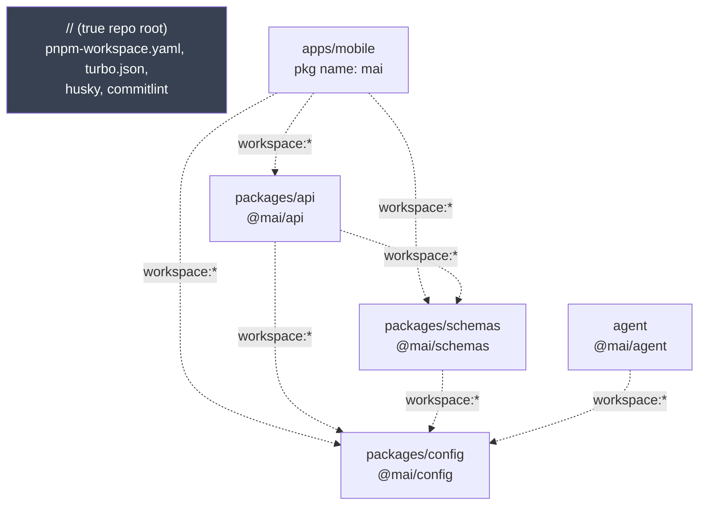
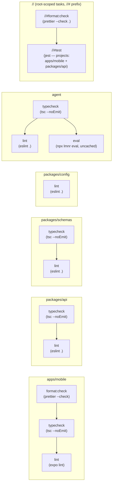
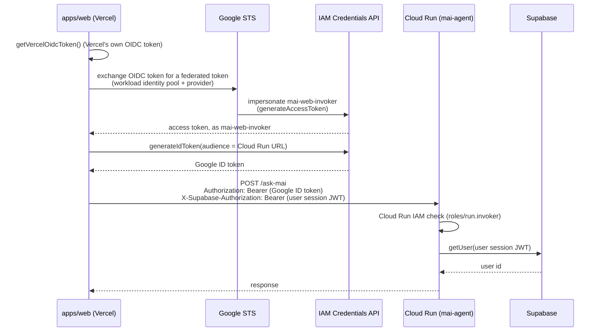

# mai

A daily-allowance budgeting app for iOS, Android, and web, built with Expo.

mai turns your monthly income, fixed costs, and savings goal into a single number: **how much you can spend today**. Log expenses against that daily allowance, track recurring income and fixed costs, and review spending patterns over time — all with a fully accessible, offline-first mobile UI.

## Core concept

The daily allowance is the monthly surplus spread evenly across the month:

```
dailyAllowance = (monthlyIncome − fixedCosts − savingsGoal) / 30
```

Each day starts with that budget; logging an expense reduces what's left for today. The **Today** tab shows the live balance, **Recurring** manages the income/cost items that feed the formula, and **Insights** aggregates historical spending by week/month and category.

## Screens

| Screen                 | Purpose                                                                           |
| ---------------------- | --------------------------------------------------------------------------------- |
| `(tabs)/index` (Today) | Daily allowance, remaining balance, quick expense entry                           |
| `(tabs)/recurring`     | Recurring income and fixed-cost items (monthly/yearly, perpetual or term-limited) |
| `(tabs)/insights`      | Spending aggregated by period and category, charts                                |
| `add-expense`          | Log a new expense                                                                 |
| `breakdown`            | Category/period breakdown detail                                                  |
| `detail`               | Single expense/recurring item detail                                              |
| `settings`             | Savings goal, preferences                                                         |
| `login`                | Supabase email/password auth                                                      |

## Architecture

This is a pnpm workspace monorepo. The app lives at `apps/mobile/` and enforces a strict
one-directional layering under `apps/mobile/src/`, so each layer only knows about the one beneath
it:

```
apps/mobile/src/app/      screens (Expo Router)   → call hooks only
apps/mobile/src/hooks/    React Query cache layer → import services only
apps/mobile/src/services/ business logic          → import @mai/api + src/data only
packages/api/             Supabase data layer (@mai/api)
apps/mobile/src/data/     local device persistence → AsyncStorage only (theme preference)
```

- **`apps/mobile/src/app/`** — file-based routes (Expo Router). Screens are presentation only; all state and logic is delegated to hooks.
- **`apps/mobile/src/hooks/`** — TanStack React Query wrappers (`useQuery`/`useMutation`, optimistic updates). All cache keys are centralized in `apps/mobile/src/hooks/query-keys.ts`.
- **`apps/mobile/src/services/`** — pure business logic: the allowance formula, expense/recurring/savings domain models and mappers, insights aggregation, auth rules. No framework or storage dependencies — this is the most heavily unit-tested layer.
- **`packages/api/`** (`@mai/api`) — the Supabase data layer: auth/session, expenses, recurring items, savings goal, savings targets, avatar storage. Framework-agnostic (no React Native imports) — the app builds the Supabase client and hands it in, so this package could be reused by a future non-mobile client.
- **`apps/mobile/src/data/`** — the one remaining local-only persistence layer: currently just the theme preference, via `AsyncStorage`.

Supporting directories (all under `apps/mobile/src/`):

- `components/` — shared UI (`ui/` = design-system primitives) plus screen-specific components (`today/`, `insights/`, `recurring/`, `detail/`, `settings/`, `auth/`).
- `constants/` — theme tokens (colors, spacing) and category definitions.
- `i18n/` — i18next setup and locale strings (`locales/en.json`); all UI copy is externalized, no hardcoded strings.
- `utils/` — small framework-agnostic helpers (dates, ids).
- `types/` — shared TypeScript types.

Plus `packages/config` (shared tsconfig/eslint/prettier bases), `packages/schemas` (framework-agnostic zod row schemas), and `agent/` (a standalone AI agent package, its own tsconfig/deps).

### Workspace dependency graph



Dotted arrows are `package.json` dependencies (how pnpm resolves symlinks) — `turbo.json` never references them with `^task`, so this graph doesn't drive turbo's execution order, only module resolution.

### Turborepo task pipeline



Each subgraph runs independently and in parallel (turbo caps concurrency by CPU, not by cross-package deps — see above). Within a subgraph, the chain comes from `turbo.json`'s `dependsOn`: `typecheck` waits on that _same package's_ `format:check`, `lint` waits on `typecheck`; a package missing a step (e.g. `packages/config` has no `typecheck`) just skips to the next one it does have. `pnpm exec turbo run typecheck lint format:check test` — what CI and the pre-commit hook both run — fires this whole graph in one invocation.

## Tech stack

- **[Expo](https://expo.dev) / React Native 0.86** — cross-platform app shell (iOS, Android, web), with the **React Compiler** enabled for automatic memoization.
- **[Expo Router](https://docs.expo.dev/router/introduction/)** — file-based, typed navigation.
- **[TanStack React Query](https://tanstack.com/query)** — async state/cache management with optimistic updates.
- **[Supabase](https://supabase.com)** — authentication (email/password) and session management.
- **AsyncStorage** — on-device persistence for expenses, recurring items, savings goal, and settings.
- **[react-native-reanimated](https://docs.swmansion.com/react-native-reanimated/) / react-native-gesture-handler** — animations and gestures.
- **[react-native-gifted-charts](https://github.com/Abhinandan-Kushwaha/react-native-gifted-charts)** — insights charts.
- **[i18next](https://www.i18next.com/) / react-i18next** — internationalization.
- **[date-fns](https://date-fns.org/)** — date math for allowance and insights periods.
- **TypeScript** (strict mode) — throughout.
- **Jest / jest-expo** — unit testing, focused on the `services`/`data` layers.

## Agent service authorization (apps/web ↔ Cloud Run)

`agent/` is a standalone service (deployed on Cloud Run) that `apps/web` calls through a
same-origin proxy (`apps/web/app/api/ask-mai/*`). Every request crosses two independent
authorization layers, plus a third, unrelated grant that only concerns the agent's own startup:

1. **GCP layer — "is this caller allowed to invoke the agent at all?"** Cloud Run's own IAM check,
   enforced before the container even runs. `apps/web` has no static credential for this — it
   mints a short-lived Google ID token at request time via Workload Identity Federation (WIF),
   using Vercel's own OIDC token as proof of identity (`lib/gcp-auth.ts`). No GCP key ever exists
   on either side.
2. **App layer — "which user is this request for?"** The end user's Supabase session JWT, carried
   in `X-Supabase-Authorization` (not `Authorization` — that header is reserved for #1, consumed by
   Cloud Run's front door before the request reaches the agent). The agent verifies it directly
   against Supabase (`agent/src/server.ts`'s `authenticate()`), independent of whatever GCP identity
   called it.



Three separate IAM grants, each scoped to a different identity/purpose — conflating any two of
these during setup is the most common way this breaks:

| Grant                                        | On                                | To                            | Why                                                                                                                         |
| -------------------------------------------- | --------------------------------- | ----------------------------- | --------------------------------------------------------------------------------------------------------------------------- |
| `roles/iam.workloadIdentityUser`             | `mai-web-invoker` service account | the Vercel WIF pool principal | lets Vercel's OIDC identity impersonate `mai-web-invoker`                                                                   |
| `roles/iam.serviceAccountOpenIdTokenCreator` | `mai-web-invoker`                 | `mai-web-invoker` itself      | the impersonated access token needs this (self-referential) to mint an ID token, a separate check from impersonation itself |
| `roles/run.invoker`                          | `mai-agent` Cloud Run service     | `mai-web-invoker`             | lets that identity actually call the service, once past the IAM front door                                                  |

**Unrelated third thing:** Cloud Run's own _runtime_ identity (the default compute service
account, since `mai-agent` doesn't use a custom one) needs `roles/secretmanager.secretAccessor`
— granted at the project level — to resolve its `--set-secrets` env vars (`ANTHROPIC_API_KEY`,
`SUPABASE_ANON_KEY`, `LMNR_PROJECT_API_KEY`, the `MCP_*_DATABASE_URL`s) at container startup. This
is a different service account, solving a different problem, from the two layers above.

## Accessibility

The app targets full screen-reader support (VoiceOver/TalkBack): every interactive element has an `accessibilityRole` and meaningful label, stateful controls expose `accessibilityState`, decorative elements are hidden from assistive tech, color contrast meets WCAG AA, and dynamic content (errors, live totals) is announced via live regions. See `CLAUDE.md` for the full ruleset.

## Getting started

1. Install dependencies:

   ```bash
   pnpm install
   ```

2. Configure Supabase — copy `apps/mobile/.env.example` to `apps/mobile/.env` and fill in your project's URL/anon key (either a local `supabase start` instance or a hosted project):

   ```bash
   cp apps/mobile/.env.example apps/mobile/.env
   ```

3. Start the app (from `apps/mobile/`):

   ```bash
   cd apps/mobile
   pnpm start
   ```

   From there, open it in a [development build](https://docs.expo.dev/develop/development-builds/introduction/), Android emulator, iOS simulator, or [Expo Go](https://expo.dev/go). Or target a platform directly with `pnpm ios` / `pnpm android` / `pnpm web`.

## Scripts

Run from the repo root unless noted. Package-scoped commands can also run via `pnpm --dir apps/mobile <script>` instead of `cd`-ing in.

| Command                                              | Description                                                      |
| ---------------------------------------------------- | ---------------------------------------------------------------- |
| `pnpm test`                                          | Run the full Jest suite (app + `@mai/api`)                       |
| `pnpm format` / `format:check`                       | Format/check with Prettier, repo-wide                            |
| `pnpm exec turbo run typecheck`                      | Typecheck every workspace package                                |
| `pnpm exec turbo run lint`                           | Lint every workspace package                                     |
| _(in `apps/mobile/`)_ `pnpm start`                   | Start the Metro dev server                                       |
| _(in `apps/mobile/`)_ `pnpm ios` / `android` / `web` | Start on a specific platform                                     |
| _(in `apps/mobile/`)_ `pnpm lint`                    | Lint the app with `expo lint`                                    |
| _(in `apps/mobile/`)_ `pnpm test:watch`              | Run just the app's tests in watch mode                           |
| _(in `apps/mobile/`)_ `pnpm smoke`                   | Round-trip every Supabase resource against a real local instance |

## Testing

Tests live next to the code they cover (`<name>.test.ts`) and target the `services`/`data` layers (`apps/mobile/`) and `@mai/api` (`packages/api/`) — pure business logic (allowance formula, mappers, aggregation) and persistence behavior. `pnpm test` from the repo root fans out to each package's own `test` script via turbo, cached independently per package.

## Project conventions

Full contributor guidelines — layering rules, component conventions, i18n, accessibility, and testing philosophy — live in [`CLAUDE.md`](./CLAUDE.md) (plus `apps/mobile/CLAUDE.md` and `apps/web/CLAUDE.md` for app-scoped rules).
